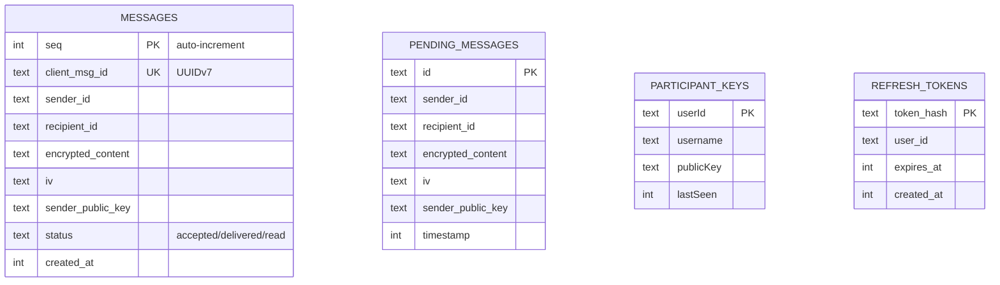

# Chatti: Prototype → Production Hardening Plan

Based on the [DEV_BRANCH_TECHNICAL_AUDIT.md](file:///home/mohsine/Proyectos/chatti/DEV_BRANCH_TECHNICAL_AUDIT.md) and a full code review of all 4 worker source files, 6 frontend services, and the legacy server.

## Current State Summary

| Component | File | Lines | Role |
|-----------|------|-------|------|
| Worker Router | [index.js](file:///home/mohsine/Proyectos/chatti/workers/src/index.js) | 1682 | Auth, contacts, DM/room routing, KV CRUD |
| ChatRoom DO | [ChatRoom.js](file:///home/mohsine/Proyectos/chatti/workers/src/ChatRoom.js) | 413 | Room broadcast (ephemeral, no history) |
| DirectMessage DO | [DirectMessage.js](file:///home/mohsine/Proyectos/chatti/workers/src/DirectMessage.js) | 561 | 1:1 encrypted relay + offline pending queue |
| EncryptionService | [EncryptionService.js](file:///home/mohsine/Proyectos/chatti/src/services/EncryptionService.js) | 292 | DH Group14 + XOR stream cipher |
| DirectMessageService | [DirectMessageService.js](file:///home/mohsine/Proyectos/chatti/src/services/DirectMessageService.js) | 467 | WebSocket client + decrypt |
| Legacy Server | [server/index.js](file:///home/mohsine/Proyectos/chatti/server/index.js) | 77 | Stranded Socket.IO server (unused) |

---

## User Review Required

> [!IMPORTANT]
> **Scope Decision**: This is a major overhaul (~2-3 weeks of work across 5 phases). I recommend doing phases incrementally, deploying and testing each one, rather than a single big-bang rewrite. **Do you want me to start with Phase 1 only (auth + security), or do you want the full plan executed?**

> [!WARNING]
> **Breaking Change - Legacy Server**: The `server/` directory (Socket.IO) is completely disconnected from the Worker stack. The plan proposes deleting it. **Is the legacy server still used anywhere (e.g., local development, other clients)?**

> [!IMPORTANT]
> **Mobile Client Impact**: The mobile app at `/home/mohsine/Proyectos/chatti-mobile` will need matching changes for auth (JWT headers) and crypto upgrades. **Should I include mobile app modifications in the plan, or will those be a separate effort?**

---

## Phase 1: Authentication & Security (P0) — ~2 days

The most critical gap. Currently **any caller can invoke any endpoint** with arbitrary `userId` values. No session tokens, no JWT.

### Architecture Decision

I propose **JWT with HMAC-SHA256** (HS256), fully runnable inside Cloudflare Workers without external dependencies:

- **Access tokens**: 15-minute TTL, stored in memory by mobile/web client
- **Refresh tokens**: 30-day TTL, stored in KV with `expirationTtl`
- **Secret key**: Stored as a Wrangler secret (`JWT_SECRET`)

---

### [NEW] `workers/src/auth.js` — JWT utility module

```
- signJWT(payload, secret, expiresInSeconds)  → token string
- verifyJWT(token, secret)  → decoded payload or throws
- extractBearerToken(request)  → token string or null
- authMiddleware(request, env)  → { userId, username } or Response(401)
```

Uses `crypto.subtle.importKey` + `crypto.subtle.sign/verify` (Web Crypto API, native in Workers).

---

### [MODIFY] [index.js](file:///home/mohsine/Proyectos/chatti/workers/src/index.js)

1. **Login/Register endpoints** — return `{ accessToken, refreshToken }` alongside user data
2. **New endpoint** `POST /api/auth/refresh` — accepts refresh token, returns new access token
3. **Auth middleware** on all `/api/*` routes except `/api/auth/login`, `/api/auth/register`, `/health`
4. **Remove `userId` from query params** — extract from JWT instead (e.g., `getUserConversations` currently trusts `?userId=...`)
5. **Lock CORS** — replace `Access-Control-Allow-Origin: *` with configurable allowed origins

### [MODIFY] [DirectMessage.js](file:///home/mohsine/Proyectos/chatti/workers/src/DirectMessage.js)

- WebSocket `join` message must include the JWT access token
- `handleJoin` verifies token before accepting the connection
- Reject unauthenticated sockets with close code `4401`

### [MODIFY] [ChatRoom.js](file:///home/mohsine/Proyectos/chatti/workers/src/ChatRoom.js)

- Same WebSocket auth pattern as DirectMessage

### [MODIFY] [wrangler.toml](file:///home/mohsine/Proyectos/chatti/workers/wrangler.toml)

- Add `JWT_SECRET` as secret binding (set via `wrangler secret put JWT_SECRET`)

### Frontend Changes

#### [MODIFY] [ApiService.js](file:///home/mohsine/Proyectos/chatti/src/services/ApiService.js)
- Store access/refresh tokens in `localStorage`
- Attach `Authorization: Bearer <token>` to all API calls
- Implement token refresh on 401 responses

#### [MODIFY] [DirectMessageService.js](file:///home/mohsine/Proyectos/chatti/src/services/DirectMessageService.js)
- Include token in WebSocket `join` message

#### [MODIFY] [ChatService.js](file:///home/mohsine/Proyectos/chatti/src/services/ChatService.js)
- Include token in WebSocket `join` message

---

## Phase 2: Messaging Reliability (P0) — ~3 days

### Message State Machine

```
client_msg_id (UUIDv7, client-generated)
     ↓
  [queued]  — client outbox
     ↓
  [accepted] — server ACK with server_seq
     ↓
  [delivered] — recipient received
     ↓
  [read] — recipient opened (future)
```

### [MODIFY] [DirectMessage.js](file:///home/mohsine/Proyectos/chatti/workers/src/DirectMessage.js)

1. **Stop dropping tables** — remove `DROP TABLE IF EXISTS encrypted_messages` from `initDB()`
2. **Add durable message table**:
   ```sql
   CREATE TABLE IF NOT EXISTS messages (
     seq INTEGER PRIMARY KEY AUTOINCREMENT,
     client_msg_id TEXT UNIQUE NOT NULL,
     sender_id TEXT NOT NULL,
     recipient_id TEXT NOT NULL,
     encrypted_content TEXT NOT NULL,
     iv TEXT NOT NULL,
     sender_public_key TEXT,
     status TEXT DEFAULT 'accepted',
     created_at INTEGER NOT NULL
   );
   ```
3. **Idempotent ingest** — `INSERT OR IGNORE` by `client_msg_id`; if already exists, return prior record
4. **Server ACK event** — on successful insert, send `{ type: 'ack', client_msg_id, seq, status: 'accepted' }` back to sender
5. **Delivery confirmation** — when message is sent to recipient's socket, send `{ type: 'delivered', seq }` to sender
6. **Cursor-based sync** — new endpoint `GET /messages?after_seq={seq}&limit={n}` returns messages after a given sequence number
7. **Retention policy** — configurable TTL (default 30 days), background cleanup via `alarm()`

### [MODIFY] [ChatRoom.js](file:///home/mohsine/Proyectos/chatti/workers/src/ChatRoom.js)

1. **Stop dropping tables** — remove `DROP TABLE IF EXISTS messages`
2. **Add room message table** (similar schema, plaintext `content` instead of `encrypted_content`)
3. **Sequence-based history** — `getHistory()` returns real messages with cursor pagination
4. **Retention** — 7-day default for room messages

### [NEW] `workers/src/MessageProtocol.js`

Shared event envelope and message schema:
```js
export const MessageEnvelope = {
  version: 1,
  type: 'string',
  payload: 'object',
  timestamp: 'number'
};
```

### Frontend Changes

#### [MODIFY] [DirectMessageService.js](file:///home/mohsine/Proyectos/chatti/src/services/DirectMessageService.js)

1. **Generate UUIDv7 `client_msg_id`** for each outgoing message (replaces `Date.now()-random`)
2. **Client outbox** — push message to `pendingMessages[]` on send, remove on `ack` received
3. **ACK handler** — listen for `type: 'ack'` events, update message state
4. **Reconnect sync** — on reconnect, send `last_seq` to server, receive gap messages
5. **Cross-session dedup** — use `localStorage` to persist `messageIds` set (not just RAM)

---

## Phase 3: Crypto Upgrade (P0) — ~2 days

> [!CAUTION]
> The current encryption uses **DH Group 14 + XOR stream cipher**. This is **not authenticated encryption** — it provides no integrity, is vulnerable to bit-flipping attacks, and the XOR keystream repeats every 32 bytes. This MUST be replaced.

### Proposed Approach

Replace with **Web Crypto API native AES-256-GCM** (authenticated encryption with associated data):

- **Key exchange**: Keep DH Group 14 for now (it's standard), but derive key using HKDF instead of raw SHA-256
- **Encryption**: AES-256-GCM via `crypto.subtle` (provides confidentiality + integrity + authentication)
- **IV**: 96-bit random nonce per message (GCM standard)

> [!IMPORTANT]
> **Alternative: Full Signal Protocol (X3DH + Double Ratchet)**. This provides forward secrecy and future secrecy but is significantly more complex (~1 week extra). **Do you want AES-GCM (simpler, solid security) or full Signal Protocol (gold standard)?**

### [MODIFY] [EncryptionService.js](file:///home/mohsine/Proyectos/chatti/src/services/EncryptionService.js)

1. **Replace `encryptMessage`** — use `crypto.subtle.encrypt('AES-GCM', ...)` instead of XOR
2. **Replace `decryptMessage`** — use `crypto.subtle.decrypt('AES-GCM', ...)`
3. **Add HKDF key derivation** — `crypto.subtle.deriveKey` with HKDF from DH shared secret
4. **Version tag on ciphertext** — prefix encrypted messages with `v2:` to allow decryption of old messages during migration
5. **Backward compatibility** — detect `v1` (XOR) messages and decrypt with old method during transition period

### Mobile App (chatti-mobile)

The mobile `EncryptionService` must be updated in lockstep to use AES-GCM with identical parameters.

---

## Phase 4: Offline-First & Sync (P1) — ~3 days

### [NEW] `src/services/OutboxService.js`

Client-side offline message queue:
- **IndexedDB store** for pending messages (survives app restart)
- **Retry with exponential backoff + jitter** (base 1s, max 30s, factor 2)
- **Dedup by `client_msg_id`** — never send same message twice
- **Drain queue** when WebSocket reconnects
- **Status tracking** — `queued → sending → acked → failed`

### [MODIFY] [DirectMessageService.js](file:///home/mohsine/Proyectos/chatti/src/services/DirectMessageService.js)

1. **Integration with OutboxService** — `sendMessage()` goes to outbox first, not directly to WebSocket
2. **Reconnect protocol** — on reconnect, send `{ type: 'sync', last_seq: N }` to get missed messages
3. **Improved reconnect** — exponential backoff with jitter (currently linear), configurable max attempts
4. **Message cache in IndexedDB** — persist decrypted message cache for offline viewing (optional, opt-in per conversation)

### [MODIFY] [DirectMessage.js](file:///home/mohsine/Proyectos/chatti/workers/src/DirectMessage.js)

1. **Handle `sync` message type** — return messages with `seq > last_seq`
2. **Delivery reconciliation** — track what each client has acknowledged

---

## Phase 5: Cleanup & Observability (P1/P2) — ~1 day

### [DELETE] `server/` directory

The legacy Socket.IO server is completely disconnected from the Worker architecture. It serves no purpose.

### [MODIFY] [index.test.js](file:///home/mohsine/Proyectos/chatti/workers/src/index.test.js)

Fix stale tests:
- Line 73: Test expects `totalMessages` but ephemeral `getRoomInfo` doesn't return it → update assertion
- Line 147: Test expects `messages.length > 0` but ephemeral `getHistory` always returns empty → either update test for ephemeral mode OR update after Phase 2 when history is durable again

### [MODIFY] [index.js](file:///home/mohsine/Proyectos/chatti/workers/src/index.js) — Bug fixes

1. **Line 975**: Conversation sorting uses `createdAt` but conversation objects use `lastMessageTime` → change sort to `lastMessageTime`
2. **`generateDiscriminator`** scans KV sequentially (up to 9999 GETs worst case!) → use a counter key `user:discrim_counter:{username}` instead
3. **Sensitive data in error responses** — line 421 returns `stack` trace in production → remove

### [NEW] `workers/src/metrics.js`

Lightweight observability (emit to `console.log` in structured JSON, parseable by Cloudflare Logpush):
- Message ingest latency
- Queue depth per conversation
- ACK success/failure rate  
- WebSocket reconnection events
- Dedup hit rate

---

## Data Model Changes Summary



---

## Migration Strategy

Each phase includes a Durable Object migration tag in `wrangler.toml`:

| Phase | Migration Tag | Changes |
|-------|--------------|---------|
| Phase 1 | `v3` | No schema change (auth is at Worker layer) |
| Phase 2 | `v4` | Add `messages` table, keep `pending_messages` |
| Phase 3 | — | No schema change (crypto is client-side) |
| Phase 4 | — | Client-side IndexedDB only |

---

## Verification Plan

### Automated Tests
- `vitest run` — fix existing broken tests in Phase 5
- New test suite for JWT auth: valid/expired/missing/malformed tokens
- New test suite for message state machine: idempotent ingest, ACK timing, cursor sync
- New test suite for AES-GCM: encrypt/decrypt round-trip, backward compatibility with v1 messages

### Manual Verification
- Deploy Phase 1 → verify that unauthenticated requests return 401
- Deploy Phase 2 → verify messages persist across reload, offline queue works
- Deploy Phase 3 → verify encrypted messages can be exchanged between web and mobile
- Cross-device test: send from mobile while web is offline, verify delivery on reconnect

### Browser Testing
- Use browser subagent to test login flow, message send/receive, reconnection behavior

---

## Open Questions

> [!IMPORTANT]
> 1. **Start Phase 1 only, or full plan?** I strongly recommend Phase 1 first.
> 2. **Delete legacy `server/` directory?** It's 100% unused by the Worker stack.
> 3. **AES-GCM (simple, solid) vs Signal Protocol (gold standard)?** For a MVP targeting production, AES-GCM is sufficient.
> 4. **Include mobile app changes in this effort?** The mobile app needs matching auth + crypto updates.
> 5. **CORS policy**: What domains should be allowed? Currently `*` (all origins).
